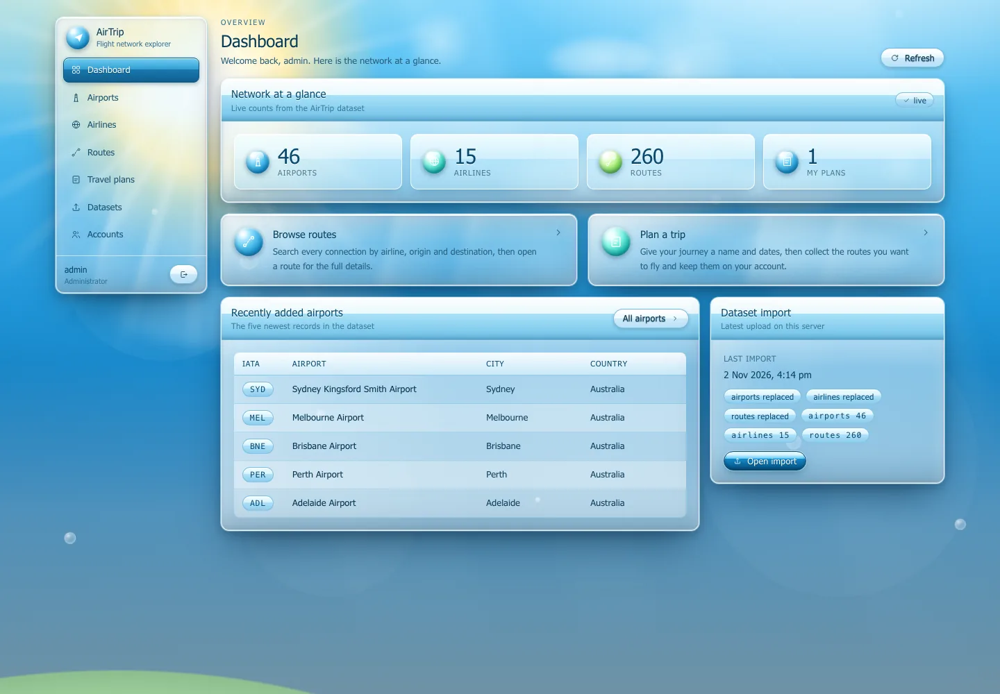
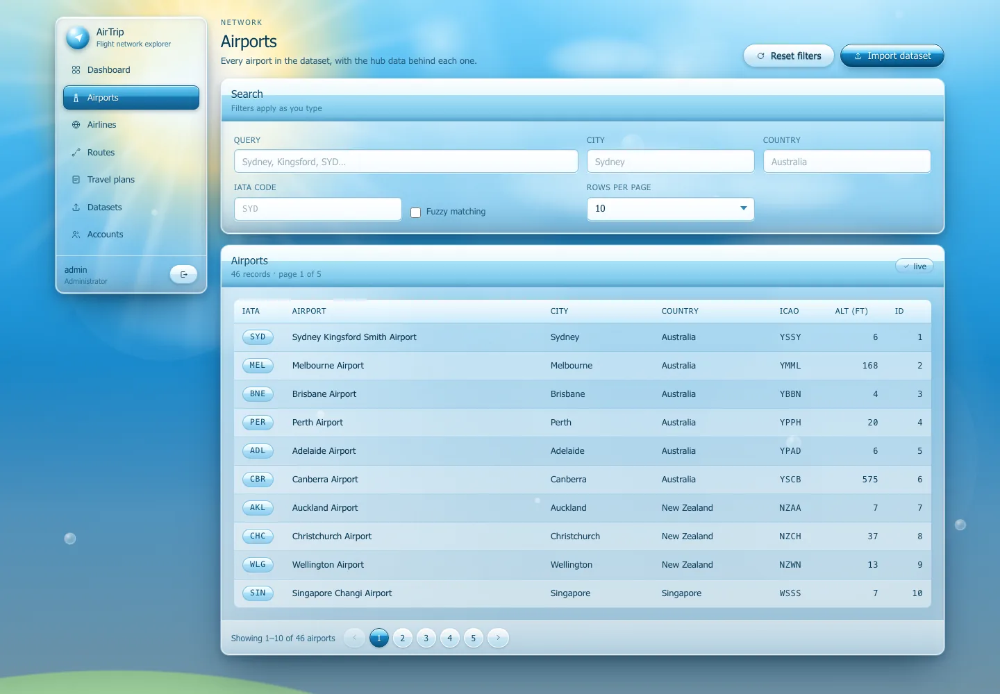
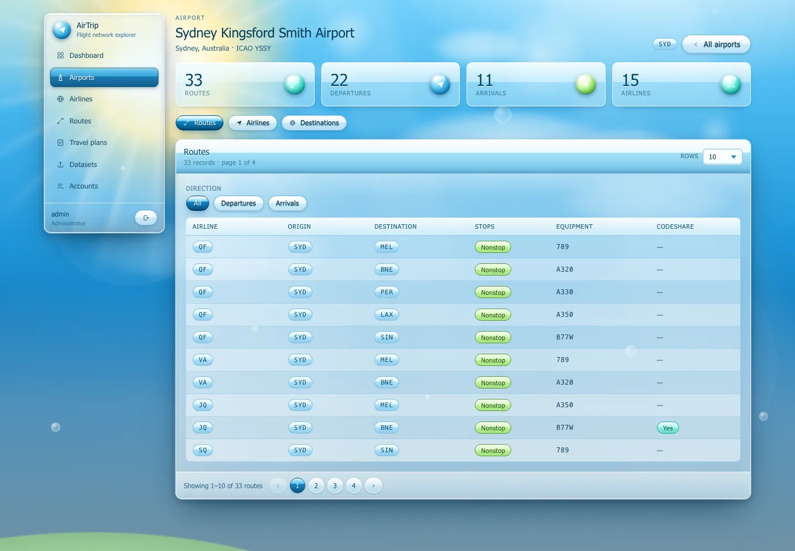
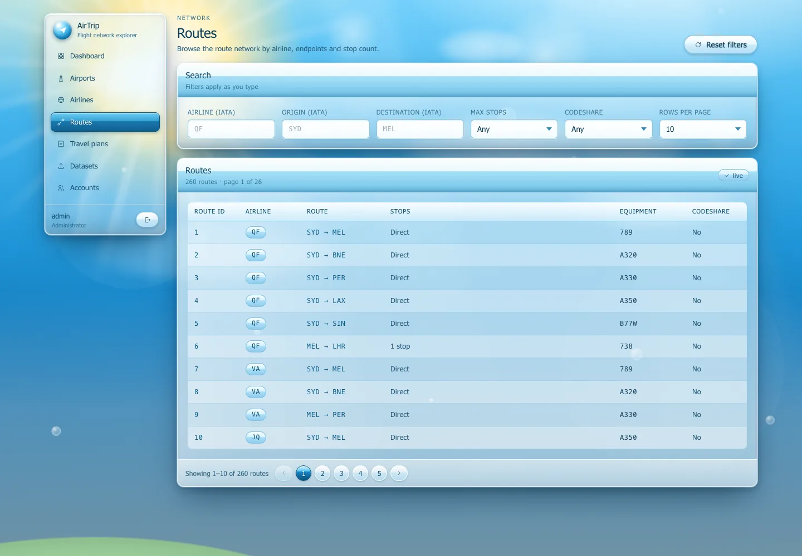
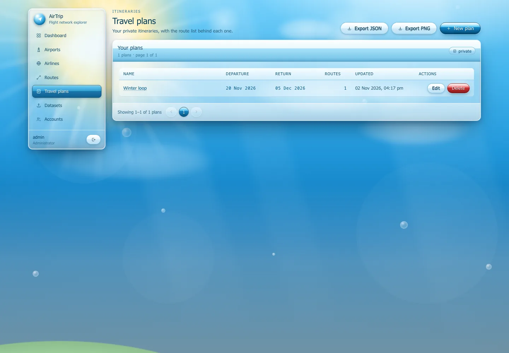
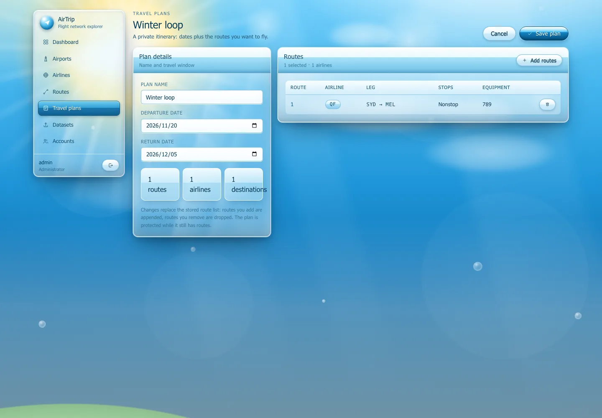
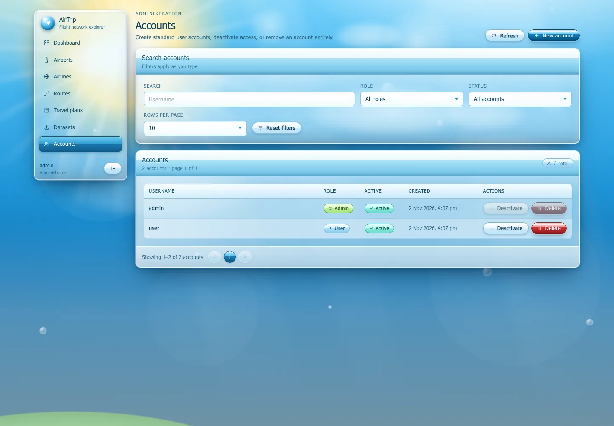
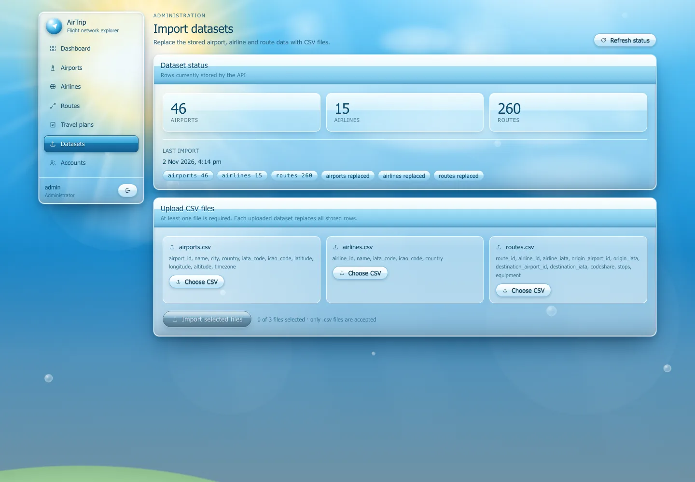

# AirTrip Web 客户端

**简体中文** · [English](README.en.md)

AirTrip API 的前端：Vue 3 + Vite + TypeScript + Tailwind 4 + Pinia 单页应用。
生产环境下由 Flask 挂在 `/app/` 提供（Swagger 仍在 `/docs`），所以不需要
单独跑一个前端服务器。

## 运行

```bash
# 1. 先起 API（在仓库根目录）
.venv/bin/python airtrip_api.py        # http://127.0.0.1:5000

# 2. 再起前端开发服务器
npm install
npm run dev                            # http://127.0.0.1:5173/app/
```

开发服务器把 `/api` 代理到 `127.0.0.1:5000`，所以改前端时 JWT 那一套照常
能用。要出生产包：

```bash
npm run build                          # 产物写入 dist/，由 Flask 在 /app/ 提供
```

登录账号：`admin` / `admin`（或 `user` / `user`）。数据集导入在
`/app/import`，需要管理员账号。

## 页面

| 路由 | 页面 |
| --- | --- |
| `/login` | 登录 |
| `/dashboard` | 计数、快捷入口、最近机场、最后一次导入 |
| `/airports`、`/airports/:iata` | 机场列表；详情含航线 / 航司 / 目的地 |
| `/airlines`、`/airlines/:iata` | 航司列表；详情含该航司的航线 |
| `/routes` | 航线浏览器，点开是详情抽屉 |
| `/plans`、`/plans/new`、`/plans/:id/edit` | 私有行程、航线选择器、JSON/PNG 导出 |
| `/users`、`/import` | 管理员专用：账号管理与 CSV 导入 |
| `/style-tile` | 设计系统的可视化说明页 |
| `/style-tile-aqua` | 样张 v2：同样的组件，Aqua 皮肤（`src/styles/theme-aqua.css`） |

## 界面截图

| | |
| --- | --- |
|  |  |
|  |  |
|  |  |
|  |  |

设计系统本身见
[`docs/style-tile-desktop.webp`](docs/style-tile-desktop.webp)，运行中的版本是
`/app/style-tile`。Aqua 皮肤的对比样张见
[`docs/style-tile-compare.webp`](docs/style-tile-compare.webp)（上：v0，下：Aqua），
线上版本是 `/app/style-tile-aqua`。

## 目录结构

```
src/
  api/          client.ts（fetch 封装、JWT、二进制下载）+ types.ts（Swagger 类型）
  components/   AeroWindow / AeroTable / AeroPager / AeroDialog / AeroDrawer / AeroIcon …
  layouts/      AppShell.vue —— 侧栏 + 内容框架
  pages/        一个页面一个文件
  stores/       auth.ts（token + 账号）、toast.ts
  styles/       aero.css —— 整套设计系统（token + 组件）
  router.ts     路由表与登录/管理员守卫
```

## 设计系统

`src/styles/aero.css` 是唯一的事实来源：天空色 token、玻璃面板（`.win`，
数据密集的面板用 `.win-dense`）、冲压质感的按钮（`.btn`）、输入框、徽章、
表格，以及动画背景场景（`App.vue`）。全部是 CSS 加手绘 SVG——没有壁纸、
没有图标包、没有网络字体，所以不涉及任何第三方素材授权。

新增页面时值得守住的两条：

- **玻璃背后得有东西。** 在纯色渐变上做模糊，和不做模糊看不出区别；背景场景
  里特意放了太阳、光柱、离焦光斑和有硬边的山丘，就是为了让面板有东西可扭曲。
- **反光只给一级物件。** hero 光球、计数卡片、主按钮可以有反射和高光；数据
  表格保持密实安静。

## 几点说明

- API 返回的是 `{ items, page, page_size, total, pages }` 信封；列表页自己
  维护筛选和分页状态，文本输入做约 220 ms 防抖。
- 导出是**账号级**的（`/api/plans/export`），不是单个行程——API 没有提供
  按行程导出的端点。
- 日期输入用的是原生控件，占位文案跟随浏览器语言；界面其余部分固定英文。
